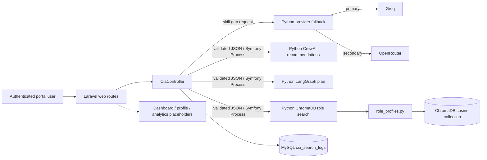

# CIA Career Intelligence


**Project 4 capstone — Cynaris Career Intelligence.** This repository snapshot
contains a Laravel/PHP integration slice backed by Python role retrieval,
structured career recommendations, a LangGraph learning plan, and skill-gap
LLM failover. It is intentionally honest about maturity: four POST actions are
controller-backed; dashboard, profile, profile-recommendation, and analytics
routes remain placeholders. This is not a claim that every route or production
integration is complete.

> **Repository boundary:** this checkout has no root `artisan` or
> `composer.json`. Its Laravel routes cannot be booted here as a standalone
> application. Run HTTP and MySQL checks from the complete Cynaris portal
> checkout. Stack badges describe the intended project stack, not versions
> independently verified from a Composer manifest in this snapshot.

## Architecture



The skill-gap fallback is Groq first and OpenRouter second. If both providers
fail, it returns a controlled error; it is not an offline successful-response
generator. The LangGraph script has separate deterministic per-stage fallback.
Symfony Process boundaries use timeouts and JSON/shape checks. See
[Architecture](docs/architecture_cia_career_w12d2.md) for scope and failure
boundaries.

## Seven-module capstone map

| # | Module | Route / status | Implementation |
| --- | --- | --- | --- |
| 1 | Career intelligence hub | `GET /cia/career/dashboard` — placeholder | Fixed JSON closure in `routes/web.php` |
| 2 | Semantic role search | `POST /candidate/cia/career/vector-search` — implemented | `CiaController::vectorSearch` → `vector_search_roles.py`, `role_profiles.py` |
| 3 | Career recommendations | `POST /candidate/cia/career/recommendations` — implemented | `CiaController::careerRecommendations` → `career_recommendations.py` |
| 4 | Skill-gap scoring | `POST /candidate/cia/career/skill-gap` — implemented | `CiaController::skillGap` → `llm_provider_fallback.py` |
| 5 | Personalized learning path | `POST /candidate/cia/career/learning-path` — implemented | `CiaController::learningPath` → `langgraph_learning_path.py` |
| 6 | Profiles and analytics | `/cia/career/profiles/*`, `GET /cia/career/recommendations/{candidate_id}`, `GET /cia/career/analytics` — placeholders | Route closures only; not backed by CIA profile/analytics persistence |
| 7 | LLM provider resilience | Internal to skill-gap action; no public route | Groq → OpenRouter; dual failure returns error |

All routes in `routes/web.php` use authentication. Profile and analytics URLs
are grouped as one portfolio module; the provider fallback is an internal
capability, not an eighth public endpoint.

## Local quickstart and verification

Use the complete Cynaris portal checkout for Laravel commands. In this task
snapshot, Python 3.11+ and project dependencies must be available; a local
`.venv` can be used as shown:

```powershell
# From this repository root
$Python = ".venv\Scripts\python.exe"
& $Python --version
& $Python scripts\verify_capstone_demo.py

# From the complete Laravel application checkout, with .env/database configured
php artisan test
php artisan serve
```

For a local role-search demo, seed the configured ChromaDB directory and submit
JSON to the CLI. First seeding may need the embedding model available locally.

```powershell
& $Python scripts\seed_chromadb_roles.py
@'
{"skills":["Python","SQL","Data Visualization"]}
'@ | & $Python scripts\vector_search_roles.py
```

The capstone verifier checks required files, route/controller wiring, PHP
syntax when `php` is installed, Python compilation, a mocked Groq-to-OpenRouter
failover, the offline ChromaDB seeding/search test, and a deterministic
LangGraph output shape. It does not start Laravel, connect to MySQL, or call
external providers. See
[the timestamped demo](docs/DEMO_SCRIPT_CIA_CAREER.md) for authenticated route
payloads and recording notes.

## Tests and benchmark evidence

- Existing Python tests cover ChromaDB role seeding/search, LangGraph plan
  validation, and provider/performance scenarios.
- The historical Week 11 local audit reports a **0.0030 s** query over a
  synthetic 1,000-vector collection and a sub-2 s test threshold. This is a
  local microbenchmark, not end-to-end role-search latency or a production SLA.
- The same audit explicitly records that live MySQL `EXPLAIN` plans were not
  captured. The composite indexes exist, but scan reduction is unverified.
- Run `python scripts/verify_capstone_demo.py` for the scoped, repeatable
  readiness scorecard; run `php artisan test` only in the full app checkout.

## Reliability and security notes

- Authenticated routes validate request fields and return `422` for invalid
  controller payloads.
- Python subprocesses receive structured JSON through stdin, have bounded
  timeouts, and are checked for process errors, invalid JSON, and invalid
  response shapes.
- Provider secrets are read from environment/configuration and passed to
  subprocesses as environment variables. Do not commit credentials.
- Search-log reads are candidate-scoped in the controller; database query
  plans still require verification against the target MySQL deployment.
- Model output is validated before use; model-provider and database failures
  are not described as successful results.

## Technical documentation

| Document | Purpose |
| --- | --- |
| [Architecture](docs/architecture_cia_career_w12d2.md) | Components, route maturity, data flow, and operational limits |
| [API contracts](docs/api-contracts-cia-career.md) | Routes, payload examples, response shapes, and caveats |
| [Implementation changelog](docs/CHANGELOG_CIA_CAREER.md) | Source-observable features and verification caveats |
| [Portfolio case study](docs/PORTFOLIO_CASE_STUDY_CIA_CAREER.md) | Engineering problem, implementation, challenges, and outcome |
| [Five-minute demo script](docs/DEMO_SCRIPT_CIA_CAREER.md) | Timestamped walkthrough, commands, route/payload cheat-sheet |
| [Week 11 performance audit](storage/logs/cia_performance_audit_w11d1.md) | Historical benchmark observations and unverified MySQL plans |
