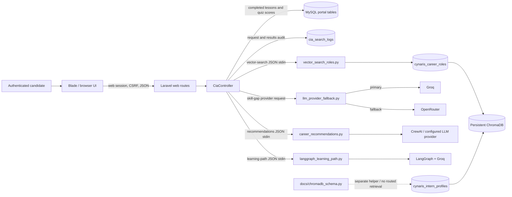

# CIA Career Intelligence Architecture and ChromaDB Schema

**Project:** Cynaris Portal (`cynaris-portal`)
**Scope:** Week 12, Day 2 architecture and implementation audit

**Status:** Describes the checked-in implementation as audited on 2026-11-17. Where an intended integration is not wired into the live routes, that gap is called out explicitly.

## 1. System overview

CIA Career Intelligence is implemented as a Laravel web application with
authenticated career routes, relational data access, and Python subprocesses
for selected AI workflows. ChromaDB is used by the role-vector-search
microservice. The candidate-profile collection helper is a separate schema
utility and is not the collection currently queried by the routed vector-search
endpoint.



### Request paths and responsibility boundaries

1. The Blade/browser client calls routes registered in `routes/web.php`.
   Because these are web routes and each CIA route has `auth` middleware,
   requests use the application's authenticated web guard and session. The
   web middleware group also provides CSRF protection for state-changing
   requests.
2. The four controller-backed POST actions validate input in
   `CiaController.php`; the controller scopes candidate identity to the
   authenticated user instead of accepting a caller-supplied identity for
   those actions.
3. `skillGap` reads completed lessons from `lesson_user` joined to `lessons`
   and completed, scored attempts from `quiz_attempts`. It computes role
   benchmarks and readiness in PHP, then invokes the LLM fallback script when
   a provider key is configured.
4. `vectorSearch`, `careerRecommendations`, and `learningPath` pass JSON
   through Symfony Process stdin to their Python entry points. They do not
   interpolate request values into a shell command.
5. Vector search queries `cynaris_career_roles` and maps ChromaDB cosine
   distances to a similarity and missing-skill list. Recommendation, learning
   path, and vector-search operations write request/result JSON to
   `cia_search_logs`.
6. `docs/chromadb_schema.py` defines `cynaris_intern_profiles`; it is not
   called by `vector_search_roles.py`, and none of the seven simple
   dashboard/profile/analytics route handlers currently reads or writes that
   collection.

### Route inventory note

`routes/web.php` currently registers ten CIA endpoints: four POST routes
under `/candidate/cia/career` and six routes in the `/cia/career` group. The
six dashboard/profile/analytics handlers return fixed readiness/placeholder
JSON; they are not yet implementations of persistent candidate profiles,
recommendations, dashboard metrics, or analytics. The separate
`CiaController::searchHistory` method has no route registration and is not a
public API endpoint.

## 2. Relational data and audit log

The relevant checked-in migrations define:

| Table | Use in CIA Career Intelligence |
| --- | --- |
| `cia_search_logs` | Stores candidate ID, optional target role, JSON request payload, JSON result/status and timestamps. |
| `lesson_user` | Supplies candidate lesson-completion records used by skill-gap analysis. |
| `lessons` | Supplies lesson title and module name to the skill-gap analysis. |
| `quiz_attempts` | Supplies completed quiz scores and skill labels to the skill-gap analysis. |

`cia_search_logs` has an indexed `candidate_id` (`varchar(191)`), nullable
`target_role` (`varchar(120)`), JSON `request_payload` and `results` columns,
and timestamps. The later migration adds `idx_user_created` on
`(candidate_id, created_at)` and `idx_user_role` on
`(candidate_id, target_role)`. The controller currently writes workflow
requests and results as JSON; the database log is separate from application
log events.

The `searchHistory` controller method filters to the authenticated
candidate, optionally filters `target_role`, and caps the result set at 50,
but no route currently exposes it.

## 3. ChromaDB collection specifications

### 3.1 Candidate-profile collection: `cynaris_intern_profiles`

The schema helper is `docs/chromadb_schema.py`. It creates a persistent
collection with metadata:

| Collection property | Specification |
| --- | --- |
| Name | `cynaris_intern_profiles` |
| Default persistence path | `docs/chroma_data` (relative to the helper's directory) |
| Distance metric | `hnsw:space = cosine` |
| Collection description | `Vector embeddings and metadata for CIA career profiles` |

The metadata builder has this exact logical input and storage representation:

| Field | Input type / constraint | Chroma metadata value |
| --- | --- | --- |
| `candidate_id` | Non-empty string after trimming | String |
| `skills` | Sequence containing only strings | JSON-encoded list stored as a string |
| `scores` | Mapping of score names to integer or float values | JSON-encoded object stored as a string |
| `history` | Sequence of mappings with string keys and JSON-compatible values | JSON-encoded list stored as a string |

Chroma metadata values are scalar; serializing `skills`, `scores`, and
`history` avoids trying to store nested lists or objects directly in metadata.
The helper does not specify the Chroma record ID, document text, embedding
function, embedding model, or a method for upserting/querying a profile.
Those are insertion/retrieval responsibilities for any future caller.
Consequently, no exact embedding dimensionality or model can be inferred for
this collection from the helper alone. If a caller supplies neither an
embedding nor an explicit embedding function, it relies on the Chroma client
default; that behavior is not configured in this schema helper.

The schema builder validates the candidate ID and that `skills` elements are
strings. It does not validate numeric finiteness/ranges in `scores`, history
record shape beyond the mapping type annotation, nor uniqueness/normalization
of skills. Callers should validate those constraints before persistence.

**Important integration boundary:** the routed role search does not query this
profile collection. It queries `cynaris_career_roles` instead. The profile
schema's default path (`docs/chroma_data`) is also different from the roles
collection's default path (`storage/app/chromadb`).

### 3.2 Live role-search collection: `cynaris_career_roles`

The role search's shared configuration is in `scripts/role_profiles.py`.

| Collection property | Specification |
| --- | --- |
| Name | `cynaris_career_roles` |
| Default persistence path | `storage/app/chromadb` |
| Override | `CIA_CHROMA_PERSIST_DIRECTORY` |
| Distance metric | `hnsw:space = cosine` |
| Seeded record count | Exactly 20 distinct role profiles |
| IDs | `role-01` through `role-20` |
| Document | Role title, required skills, and match criteria combined as text |
| Metadata | `role`, JSON string `required_skills`, `match_criteria`, `category`, `experience_level`, and `work_mode` |

`seed_chromadb_roles.py` upserts the 20 configured profiles and removes stale
IDs. The collection helper does not set a custom embedding function; current
Chroma defaults therefore apply for embedding the role documents and query
text. `vector_search_roles.py` submits a single text query beginning
`Candidate skills:`, requests up to five records with metadata and distances,
and requires exactly five results. It converts cosine distance to
`max(0, min(1, 1 - distance))`, reports the similarity as a 0-100 percentage,
and calculates `missing_skills` by case-folding and whitespace-normalizing the
submitted and required skill strings.

### 3.3 Retrieval flow

```text
POST /candidate/cia/career/vector-search
  -> Laravel validates 1-50 non-blank skills (each <= 120 chars)
  -> Symfony Process invokes scripts/vector_search_roles.py
  -> Python opens cynaris_career_roles at the configured persistence path
  -> ChromaDB ranks role documents with cosine distance
  -> Python returns five role matches and required-skill gaps as JSON
  -> Laravel validates the output shape and writes cia_search_logs
  -> Laravel responds with log_id and matches
```

This flow does not retrieve candidate vectors by `candidate_id`, and it does
not read `skills`, `scores`, or `history` from `cynaris_intern_profiles`.

## 4. AI workflows and provider fallback

| Workflow | Python component | Provider / data behavior |
| --- | --- | --- |
| Skill gap | `scripts/llm_provider_fallback.py` | Tries Groq first and OpenRouter second. The PHP controller sends skill profile, role benchmarks, and radar scores, then validates returned `gaps` and `priority_learning`. If neither provider key is configured, PHP returns local benchmark-based suggestions without starting the script. |
| Career recommendations | `scripts/career_recommendations.py` | Uses CrewAI with a configured LLM to generate exactly three typed career paths, each with required competencies, at least three milestones, and an estimated timeframe. |
| Learning path | `scripts/langgraph_learning_path.py` | Runs a five-node LangGraph flow for assessment, gap identification, plan construction, validation, and summary. It returns an eight-week schedule of seven daily topics per week and deterministic per-node fallback when the Groq key/model call fails. |
| Role vector search | `scripts/vector_search_roles.py` | Queries the seeded ChromaDB role collection; does not call an LLM directly. |

The provider fallback script limits each HTTP request to 25 seconds and emits
provider, model, timing, fallback, token-usage, and provider-status telemetry
in its JSON result. The current PHP skill-gap caller consumes the generated
content but does not include that telemetry in its public response or forward
it to a named `CIA_CAREER_TELEMETRY` event.

## 5. Reliability, security, and error handling

### Implemented controls

- **Authentication and CSRF:** CIA routes use `auth` and are registered in
  `routes/web.php` (the web middleware stack). Cookie-authenticated writes
  therefore require a valid session and CSRF token. Send `Accept:
  application/json` to receive JSON-oriented framework errors.
- **Validation:** the four controller actions have explicit field rules.
  Their `validateRequest` helper returns `422` with
  `{"status":"error","message":"The provided data is invalid.","errors":{...}}`
  for validation failures.
- **Subprocess boundary:** Python processes are started with argument arrays,
  request JSON is provided on stdin, and stdout is decoded as JSON. Nonzero
  exits, malformed JSON, and invalid result shapes are rejected rather than
  returned as successful responses.
- **Timeouts:** career recommendations use a 90-second process limit;
  learning paths use 240 seconds; vector search uses 90 seconds; and the
  skill-gap fallback process uses 55 seconds. Timed-out operations return
  `504`; start failures, process errors, and invalid service output generally
  return `502`.
- **Candidate scope:** candidate IDs for the controller-backed operations are
  taken from the authenticated user. Skill-gap reads and search-history
  filtering are scoped to that user.
- **Persistence indexes:** the CIA log indexes cover candidate/time and
  candidate/role filtering.

### Audited gaps and expected operational behavior

- **Database exceptions:** the audited `CiaController.php` contains no
  `QueryException` import or explicit catch. Database failures in lesson/quiz
  reads or CIA log writes therefore flow to Laravel's exception handler; the
  CIA controller does not itself isolate the failure or guarantee a
  controller-defined JSON `500` shape. A deployment should verify the global
  exception handler's JSON response and logging behavior. The API contract
  documents a generic server failure, not a bespoke `QueryException` body.
- **Named telemetry:** the audited source contains no `CIA_CAREER_TELEMETRY`
  identifier or structured telemetry event contract in the controller. It
  emits Laravel `Log` messages for process/provider failures and records
  workflow request/results in MySQL. The Python provider helper returns
  structured provider telemetry internally, but PHP currently discards it.
- **Profile collection wiring:** the `cynaris_intern_profiles` utility has no
  route-facing upsert/query service in the audited code. Do not treat the
  schema as an active candidate-profile persistence API.
- **Placeholder routes:** the dashboard, profile CRUD, profile
  recommendations, and analytics route handlers return fixed JSON rather
  than database-backed values. Their response examples in the API reference
  describe the actual fixed response shapes.

### Public error conventions

| Status | Meaning in the controller-backed endpoints |
| --- | --- |
| `401` | No authenticated session/guard; response body is supplied by Laravel's auth exception handling and depends on JSON negotiation. |
| `419` | Invalid/missing CSRF token for a session-authenticated state-changing request. |
| `422` | Input validation failure, with field-specific `errors`. |
| `500` | Controller-side JSON preparation failure or uncaught application/database exception handled by Laravel. Database failures are not explicitly caught in this controller. |
| `502` | Python process start/execution failure, malformed output, or invalid output structure. |
| `504` | Python subprocess timed out; provider timeout failures may also map to this status. |

Workflow errors may include a `log_id` when the controller successfully wrote
the failed attempt to `cia_search_logs`. If the database itself is unavailable,
the failure record may not be writable.

## 6. Operational configuration

| Setting | Purpose | Default / notes |
| --- | --- | --- |
| `CIA_PYTHON_BINARY` | Python executable used by Laravel subprocesses | `python` |
| `CIA_CHROMA_PERSIST_DIRECTORY` | Role collection persistence path | `storage/app/chromadb` |
| `GROQ_API_KEY`, `GROQ_MODEL` | Primary LLM for skill-gap fallback and learning paths | Model defaults to `llama-3.3-70b-versatile` |
| `OPENROUTER_API_KEY`, `OPENROUTER_MODEL` | Secondary provider for skill-gap fallback | Model defaults to `openai/gpt-4o-mini` |
| `CREWAI_MODEL` | CrewAI career recommendation model | Defaults to `openai/gpt-4o-mini` |

Provider secrets must be supplied through deployment environment/configuration
and must not be written to logs or source control. Seed the live role collection
with `python scripts/seed_chromadb_roles.py` before using vector search. The
default embedding model may need to be downloaded on first use when ChromaDB's
default embedding function is selected.

## 7. Source map

- Routes: [`routes/web.php`](../routes/web.php)
- Controller: [`CiaController.php`](../app/Http/Controllers/CiaController.php)
- Candidate-profile schema utility: [`chromadb_schema.py`](./chromadb_schema.py)
- Role collection and profiles: [`role_profiles.py`](../scripts/role_profiles.py)
- Role seeding and query: [`seed_chromadb_roles.py`](../scripts/seed_chromadb_roles.py), [`vector_search_roles.py`](../scripts/vector_search_roles.py)
- LLM fallback: [`llm_provider_fallback.py`](../scripts/llm_provider_fallback.py)
- Career recommendations: [`career_recommendations.py`](../scripts/career_recommendations.py)
- Learning path: [`langgraph_learning_path.py`](../scripts/langgraph_learning_path.py)
- API contract: [`api-contracts-cia-career.md`](./api-contracts-cia-career.md)
