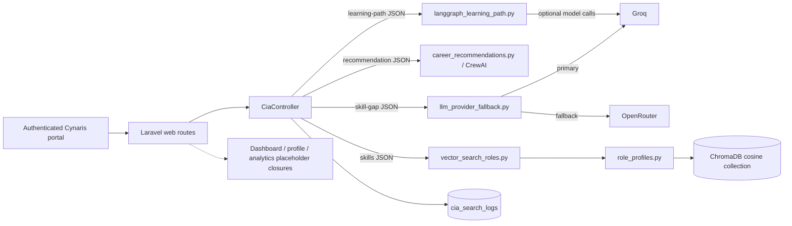

# CIA Career Intelligence — Architecture

## Scope and implementation status

This document describes the files present in this repository snapshot. Four
authenticated POST routes are controller-backed: skill-gap analysis, career
recommendations, learning-path generation, and vector role search. The
dashboard, profile CRUD, profile recommendations, and analytics routes in
`routes/web.php` are JSON placeholder closures; they do not yet read or write
candidate profile records. The project is therefore a working AI feature slice,
not a completed seven-module production service.

The repository snapshot does not contain `artisan` or `composer.json`. Laravel
HTTP integration and database behavior cannot be booted from this checkout
alone. See the [API contract](api-contracts-cia-career.md) for request and
response examples, including its placeholder caveats.

## Request and data flow

Laravel validates request fields, supplies the authenticated candidate
identifier where applicable, and starts Python programs with Symfony Process.
The controller applies operation-specific timeouts, checks process status,
decodes JSON with exceptions enabled, validates response shapes, and records
success or failure data in `cia_search_logs`. Provider credentials are passed
to the relevant child process through environment variables rather than command
arguments.

## Components

| Component | Responsibility | Current boundary |
| --- | --- | --- |
| `routes/web.php` | Authenticated routes | Four controller actions; six placeholder closures |
| `CiaController` | Validation, process lifecycle, JSON contract checks, persistence | Skill gap, recommendations, learning path, vector search |
| `cia_search_logs` | Persist candidate-scoped request and result JSON | Indexed by candidate plus timestamp and candidate plus target role |
| `vector_search_roles.py` | Rank five roles by ChromaDB cosine distance | Requires a seeded collection of 20 roles |
| `career_recommendations.py` | Generate three structured paths through CrewAI | Requires a configured model provider |
| `langgraph_learning_path.py` | Build and validate an eight-week graph-generated plan | Five graph stages; deterministic per-stage fallback when model calls fail |
| `llm_provider_fallback.py` | Try Groq, then OpenRouter | Returns a controlled error if both providers fail; not a third provider |

`cia_search_logs` is the only CIA-specific persistence schema in this snapshot.
The candidate-profile, dashboard, and analytics placeholders are not backed by
implemented profile tables. The index migration defines `(candidate_id,
created_at)` and `(candidate_id, target_role)` indexes; live MySQL `EXPLAIN`
results are not available in the repository's performance audit.

## Reliability and verification boundaries

The controller uses bounded process timeouts and explicit error responses for
start failures, timeouts, nonzero exits, invalid JSON, and invalid response
shapes. Request validation returns `422`. Learning-path output is constrained
to eight weeks of seven days each. Vector search rejects empty skill lists and
requires five results from a collection containing 20 role records.

Local Python tests and syntax checks can verify script behavior without
provider credentials. They do not prove authenticated HTTP-to-database
integration, live provider availability, production latency, or a MySQL query
plan. The demo and verification guide distinguishes those checks explicitly.
